# Email-to-CRM

Email-to-CRM is an n8n workflow that turns forwarded emails into CRM contacts. Staff forward an email to one intake mailbox. The workflow finds the people in it with a small language model running on your own hardware, checks every field against the email text, upserts each contact into Zoho CRM, and replies to the forwarder with what was saved and a link that undoes it for 24 hours.

Email bodies stay on your network. Extraction runs on `llama3.2:3b` in Ollama, next to n8n. Outbound traffic is the Zoho API, the Microsoft Graph mailbox and Excel calls, DNS lookups for addresses written without a domain ending, a one-time download of tesseract language data from GitHub, and, for contacts that arrive incomplete, plain HTTP fetches of public company web pages. A hosted research step exists in `Web_Research.js` and is switched off; it would send a contact's name, company and email to Perplexity, so turning it on is a privacy decision for your organization.

## Using it

Forward an email to the intake mailbox. A short note above the forwarded message tells the workflow who to add and as what type. This is the email in test fixture `threads-001`, shown as text:

```text
From:    Pat Staffer <pat@yourcompany.com>
To:      Contacts <contacts@yourcompany.com>
Subject: FW: Equipment remarketing - intro

Broker for zoho

Pat Staffer
Managing Director | Your Company
Office (555) 010-0100 | Mobile (555) 010-0101
100 Main Street, Anytown, ST 00000
pat@yourcompany.com
Your Company Tagline Here

From: Dana Whitlock <dwhitlock@harborlinebrokers.example>
Sent: Monday, November 2, 2026 4:51 PM
To: Pat Staffer <pat@yourcompany.com>
Subject: Equipment remarketing - intro

Pat,
Good speaking with you this afternoon. ...

Dana Whitlock
Senior Broker | Harborline Equipment Brokers LLC
O 615-555-0134 | C 615-555-0187
2200 Riverfront Pkwy, Suite 410
Nashville, TN 37201
www.harborlinebrokers.example

CONFIDENTIALITY NOTICE: ...
```

The note is optional. Without one, the workflow decides who the contact is and picks a type from the email. With one, the note wins. It can name a type ("Broker for zoho"), a person ("Add Dana"), several people ("both of these", "add the team"), or someone to leave out ("not Sam"). The forwarder's own signature, phones and address are filtered out because they belong to your staff.

The workflow reads the message as Microsoft Graph returns it, so a test fixture is that same JSON message (`id`, `subject`, `from`, `toRecipients`, `ccRecipients`, `hasAttachments`, `body.contentType`, `body.content`, and so on) plus the expected contacts. Running the harness on this fixture:

```text
$ node tests/run.js --only threads-001
PASS threads-001 (0.0s)

                  fixtures passed  field accuracy  missed  extra  skip-reason acc
all               1/1 (100.0%)     9/9 (100.0%)    0       0      100.0%
category threads  1/1 (100.0%)     9/9 (100.0%)    0       0      100.0%
split train       1/1 (100.0%)     9/9 (100.0%)    0       0      100.0%

1 fixtures in 0.0s; model calls 0, cache hits 1
```

In the same run, Email Parser read the note as `forwarderInstruction: "Broker for zoho"` with `suggestedType: "Broker"`, and Prepare Upsert built this request for Zoho:

```json
{
  "data": [
    {
      "Email": "dwhitlock@harborlinebrokers.example",
      "Last_Name": "Whitlock",
      "First_Name": "Dana",
      "Title": "Senior Broker",
      "Phone": "615-555-0134",
      "Mobile": "615-555-0187",
      "Mailing_City": "Nashville",
      "Mailing_State": "TN",
      "Account_Name": "Harborline Equipment Brokers LLC",
      "Description": "Auto-imported via Email-to-CRM on 11/10/2026, 11:35:22 PM. Source: FW: Equipment remarketing - intro. Confidence: medium. Verification: 100%.",
      "Type": ["Broker"]
    }
  ],
  "duplicate_check_fields": ["Email"],
  "trigger": ["workflow"]
}
```

The confirmation went to `pat@yourcompany.com` with the subject `[CRM] Added 1 contact: Dana Whitlock`. Its card lists the fields Zoho now holds, notes that the contact came from the signature scanner because the model's reply missed it, and ends with the signed undo link. The street line was not captured in this run, which is why `Mailing_Street` is absent.

Other confirmation subjects are `[CRM] Updated 1 contact: ...`, `Skipped` or `Error` in the same position, `[CRM] 2 contact(s) added/updated, 1 skipped: Name +2` for several people, `[CRM] No Contact Found` when nothing with an email could be extracted, and a Zoho sync failure notice when the token refresh fails. In that last case the contacts are still in the CSV and Excel logs.

### Zoho field mapping

Prepare Upsert sends one request per contact, keyed on email. A field is sent only when it has a value that passed validation, so an empty value never overwrites what Zoho already holds.

| Zoho field | Source |
|---|---|
| `Email` | the contact's address, used as the duplicate check field |
| `First_Name`, `Last_Name` | signature, header display name, or the model; a missing surname is never guessed, so Zoho rejects a new record without one |
| `Title` | signature title line |
| `Account_Name` | signature company line; falls back to the email domain split into words |
| `Phone` | office, main, tel or direct line numbers |
| `Mobile` | cell, mobile and direct numbers, and "text me at" numbers |
| `Mailing_Street`, `Mailing_City`, `Mailing_State`, `Mailing_Country` | signature address lines; country is left empty for US contacts |
| `Type` | the forwarder's note, else the model's guess mapped onto your picklist; sent as an array because it is a multi-select |
| `Specific_Type` | optional second picklist, off unless `VALID_SPECIFIC_TYPES` is filled in |
| `Description` | `Auto-imported via Email-to-CRM on <date>. Source: <subject>. Confidence: ... Verification: ...%.` |

The Description stamp is how you can tell later which records the workflow wrote.

## How it works

The workflow has 43 nodes, 22 of them Code nodes whose JavaScript lives in `src/nodes/`. Apart from the model calls, every decision is a rule in that code, so a wrong result can be traced to the line that made it. Four HTTP nodes call Ollama, and Web Research calls it from inside its Code node.

```mermaid
flowchart TD
    T["Outlook Trigger<br/>polls every minute"] --> G["Get a message1<br/>raw Graph message"]
    G --> M["Map Outlook to Standard Format<br/>HTML to text, reject drafts, own mail,<br/>auto-replies, bounces, confirmations"]
    M --> S{"Skip Self-Sent?"}
    S -- skip --> D["Discarded (Self-Sent)"]
    S -- keep --> EP["Email Parser<br/>forwarder note, type, URLs"]
    EP --> PER["Prepare Extraction Request<br/>trim thread, scope the note, inline OCR"]
    PER --> AI["AI Contact Extractor<br/>Ollama llama3.2:3b"]
    AI --> PAR["Parse AI Response<br/>check fields against the text,<br/>signature scanner"]
    PAR --> WR["Web Research<br/>only when needsWebResearch"]
    WR --> HA{"Has Extractable Attachment?"}
    HA -- yes --> DL["Download PDF Attachments<br/>Graph API"]
    DL --> EAT["Extract Attachment Text<br/>pdftotext, tesseract, vCard"]
    EAT --> PPE["Prepare PDF Extraction"]
    PPE --> AIP["AI Extract from PDF<br/>Ollama"]
    AIP --> PPC["Parse PDF Contacts"]
    PPC --> V["Validate Contact Type<br/>drop staff and noise, settle type"]
    HA -- no --> V
    V --> NR{"Needs Research?"}
    NR -- yes --> DRU["Determine Research URL"]
    DRU --> FCW["Fetch Company Website"]
    FCW --> PRR["Prepare Research Request"]
    PRR --> AAP["AI Analyze Page<br/>Ollama"]
    AAP --> PRS["Parse Research Response"]
    PRS --> NF{"Needs Follow-Up?"}
    NF -- yes --> FFP["Fetch Follow-Up Page"]
    FFP --> PFR["Prepare Follow-Up Request"]
    PFR --> AES["AI Extract Sub-Page<br/>Ollama"]
    AES --> MR["Merge Research Results"]
    NF -- no --> MR
    NR -- no --> MR
    MR --> FSC["Final Sanity Clean"]
    FSC --> FC["Format for CSV"]
    FC --> SC["Save to CSV"]
    FC --> PDL["Prepare Dev Log Row"]
    PDL --> ADL["Append Developer Log<br/>Excel"]
    ADL --> PZL["Prepare Zoho Log Row"]
    PZL --> AZL["Append Zoho Log<br/>Excel"]
    SC --> SZ{"Skip Zoho?"}
    SZ -- "every contact blocked" --> PCE["Prepare Confirmation Email"]
    SZ -- otherwise --> RZT["Refresh Zoho Token"]
    RZT --> PU["Prepare Upsert<br/>one request per contact"]
    PU --> UC["Upsert Contact"]
    UC --> PZF["Prepare Zoho Fetch"]
    PZF --> FZC["Fetch Zoho Contact"]
    FZC --> PCE
    PCE --> SEND["Send Confirmation<br/>Outlook"]
```



Map Outlook to Standard Format turns HTML into plain text once (label and value tables become `Label: value` lines, look-alike Cyrillic and Greek letters and fullwidth digits are normalized, `[at]`/`[dot]` addresses are rejoined) and marks mail that must never be extracted as `skip`. Email Parser separates the forwarder's note from the forwarded content. Prepare Extraction Request works out what the note asks for and puts that, with the trimmed thread, in front of the model.

Parse AI Response is the largest node. It accepts a value from the model only when it can be found in the email, and its signature scanner reads the lines around each outside email address for name, title, company, phones and address. The scanner runs whether or not the model call succeeded, so a failed or empty model reply still produces contacts. Validate Contact Type is the last filter: it removes your own staff, people who appear only on a forwarded To or Cc line, and people the note excludes, then sets each contact's type. Final Sanity Clean fixes formatting that any path can leak, such as country spellings, run-together company names and phone labels.

The CSV backup and the Excel rows are written before Zoho is called. Zoho rejects a whole batch when one record is bad, so each contact is its own upsert, followed by its own fetch so the confirmation shows what Zoho actually stored. The undo link carries the Zoho record IDs, the contact emails and an expiry 24 hours out, signed with HMAC-SHA256 using `UNDO_SECRET`. It points at an `undo-contact` webhook, and the workflow that serves that webhook is not included here.

On CPU a long forward takes a minute or two, which suits a mailbox that receives tens of emails a day. The extraction request has a 15 minute timeout.

[docs/edge-cases.md](docs/edge-cases.md) lists the email formats the rules were built against and the failures each rule fixed.

## Testing

`tests/run.js` runs the real workflow JSON and the real node code on synthetic fixtures, without n8n. Model calls go to a local Ollama at `http://localhost:11434`. Zoho, Microsoft Graph attachments, Outlook send and the Excel appends are stubbed, and outbound web fetches return 404 unless a fixture supplies the page.

Requirements are Node 18 or newer, Ollama with `llama3.2:3b` pulled, and `tesseract` and `pdftotext` on PATH for the attachment fixtures.

```bash
ollama pull llama3.2:3b
node tests/selftest.js
node tests/units.js
node tests/run.js
node tests/run.js --split holdout
node tests/run.js --category phones --json /tmp/phones.json
node tests/run.js --only threads-001,phones-007 --no-cache
```

Model replies are cached in `tests/.cache/` (gitignored), keyed by the SHA-256 of the request body, so a second run is near instant and only changed prompts reach the model. The script always exits 0; it reports, and the table is the result. `tests/selftest.js` checks the harness's own n8n semantics and `tests/units.js` checks single-node rules (calling codes, city cleanup, note rules, card phone labels), both with no model calls. The header of `tests/run.js` lists where the harness differs from a real n8n run.

A fixture passes when the skip decision matches, every expected contact is found by email with every labeled field equal (phones compared by digits), and no extra contact appears. There are 134 fixtures in six categories. 102 are in the train split, which the fixes were developed against. 32 are in the holdout split, which was kept out of that loop and is the better estimate of how the workflow does on email it has not seen. One exception: a code review named the `0034` prefix defect that `phones-016` shows, and its fix landed, so that fixture no longer counts as unseen.

Current results, from `node tests/run.js` on the committed code with the cached model replies:

| Split | Fixtures passed | Field accuracy |
|---|---|---|
| all | 124/134 (92.5%) | 905/922 (98.2%) |
| train | 102/102 | 694/694 |
| holdout | 22/32 (68.8%) | 211/228 (92.5%) |

With the cache on, no fixture missed an expected contact, added an unexpected one, or made the wrong skip decision. A fresh run with `--no-cache` (132 model calls, about 12 minutes on a laptop) scored 121/134: train 100/102, holdout 21/32, one missed and one extra contact, all in the coverage category. `llama3.2:3b` does not answer identically every time, so expect a few fixtures to move between runs. Before this round of fixes the suite had 111 fixtures and 45 of them passed. `companies-addresses-016` started passing when its address changed and the model was asked again, so read that one as model variance. The 10 holdout failures are all single-field errors:

| Fixture | What goes wrong |
|---|---|
| `adversarial-008` | office phone missed when the address exists only in a mailto link |
| `adversarial-016` | mobile missed in a two-column table signature |
| `coverage-002` | company from an Outlook vCard comes out as the domain word, and the type falls back to Industry Resource |
| `coverage-006` | LinkedIn invitation headline puts the full name in Last_Name |
| `coverage-010` | reply-all introduction: phone missed and the wrong type assigned |
| `coverage-013` | Dutch T and M labels with +31 numbers are not read |
| `coverage-021` | trade-show lead-scan digest mixes up the two badges' fields |
| `phones-012` | a fax-only line is stored as Phone |
| `threads-004` | "Investment advisor for CRM" note resolves to Industry Resource |
| `threads-020` | off-picklist type "Commercial realtor" is not mapped to Broker |

To test a change, edit the file in `src/nodes/`, rebuild the workflow JSON, and rerun:

```bash
node scripts/build-workflow.js
node scripts/build-workflow.js --check
node tests/run.js
```

`src/nodes/` is the source of truth. `workflows/email-to-crm.template.json` holds the workflow with `__SRC__:<file>` in place of each Code node's body, and the build script writes the importable `workflows/email-to-crm.json`.

## Setup

1. Copy `.env.example` to `.env` and fill in `N8N_ENCRYPTION_KEY`, `ZOHO_CLIENT_ID`, `ZOHO_CLIENT_SECRET`, `ZOHO_REFRESH_TOKEN` and `UNDO_SECRET`. `N8N_BLOCK_ENV_ACCESS_IN_NODE=false` lets the Code nodes and HTTP nodes read them. Set `WEBHOOK_BASE_URL` to the address forwarders can reach, because the undo link is built from it.
2. The Code nodes `require` `crypto`, `fs`, `child_process`, `dns`, `http`, `https` and `url`. n8n blocks built-in modules in Code nodes by default, so allow them with `NODE_FUNCTION_ALLOW_BUILTIN`. Save to CSV writes `/data/extracted_contacts.csv` and the OCR step keeps language data in `/data/tessdata`, so mount a writable volume at `/data` in the n8n container. Attachment OCR needs `pdftotext` (poppler) and `tesseract` inside the n8n image; the stock `n8nio/n8n` image has neither, so build an image on top of it.
3. `docker compose up -d`. The compose file runs n8n on port 5678, Ollama on the Docker network only, a warmup sidecar that pulls `llama3.2:3b` and keeps it loaded, and a page fetcher on port 8191 that the web research step uses for sites behind a bot challenge.
4. In n8n, create Microsoft Outlook OAuth2 credentials for the intake mailbox and Microsoft Excel credentials, then import `workflows/email-to-crm.json` and attach the credentials to the Outlook, Graph and Excel nodes.
5. Point Append Developer Log and Append Zoho Log at your workbook. The template has `WORKBOOK_ID`, `WORKSHEET_ID_DEVELOPER_LOG` and `WORKSHEET_ID_ZOHO_LOG` as placeholders.
6. Configure the workflow for your organization as described below, rebuild, re-import, and activate it.
7. On a Windows host, run `infra/onprem-windows/harden.ps1` once as administrator so the stack comes back on its own after a reboot. [The runbook](infra/onprem-windows/README.md) has the details.

## Configuring for your organization

n8n Code nodes cannot import from each other, so each node that needs your organization's details keeps its own copy in a block headed `// Organization settings` near the top of the file. Eleven files have one: `Map_Outlook_to_Standard_Format.js`, `Email_Parser.js`, `Prepare_Extraction_Request.js`, `Parse_AI_Response.js`, `Web_Research.js`, `Prepare_PDF_Extraction.js`, `Parse_PDF_Contacts.js`, `Validate_Contact_Type.js`, `Prepare_Research_Request.js`, `Prepare_Follow_Up_Request.js` and `Prepare_Confirmation_Email.js`. Edit them in `src/nodes/`, then run `node scripts/build-workflow.js`.

The placeholders to replace:

| Placeholder | Constant | Purpose |
|---|---|---|
| `yourcompany.com` | `OWN_DOMAINS` | your email domains; addresses there are never saved as contacts |
| `Pat Staffer`, `Alex Example` with their emails and titles | `OWN_STAFF` | staff whose signatures appear in forwarded mail |
| `5550100100`, `5550100101`, `5550100102` | `OWN_PHONES` | last 10 digits of your office, mobile and fax lines (Parse AI Response and Web Research) |
| `Your Company` | `OWN_COMPANY_NAMES` | never accepted as a contact's company |
| `Your Company Tagline Here` | `OWN_TAGLINE` | signature tagline (Email Parser and Parse AI Response) |
| `contacts@yourcompany.com` | `INTAKE_ADDRESS` | the intake mailbox (Map Outlook to Standard Format) |
| empty set | `KNOWN_FORWARDERS` | outside addresses allowed to send requests, such as a staff member's personal mailbox |
| `<sent-items-folder-id>`, `<drafts-folder-id>` | `SENT_ITEMS_FOLDER_ID`, `DRAFTS_FOLDER_ID` | the intake mailbox's Sent Items and Drafts folders, read once from `GET /users/<mailbox>/mailFolders/sentitems` and `/drafts` |
| `[CRM]` | `SUBJECT_TAG` | confirmation subject tag, set in Prepare Confirmation Email; Map Outlook to Standard Format uses the same value to recognize the workflow's own confirmations and replies to them, so keep the two equal |

The intake address is the mailbox the Outlook credential signs in to. `INTAKE_ADDRESS` has to match it, because mail the mailbox sends to itself and replies to its own confirmations are recognized by that address.

The fixtures are written for these placeholders. Run the harness before you replace them, or keep an unmodified copy of `src/nodes` and point the harness at it with `--src-dir`.

### Contact types and the CRM picklist

The type list ships as Attorney, Broker, Customer, Employee, Family Office, Financial Institution, Industry Resource, Insurance, Investment Advisor, Management Company, Manufacturer, Marketing, Partner and Service Provider. Replace it with your own picklist in each of these places:

| File | What to change |
|---|---|
| `Email_Parser.js` | `VALID_TYPES` and `TYPE_KEYWORDS`, which read a type from the note or subject |
| `Validate_Contact_Type.js` | `VALID_TYPES`, `TYPE_ALIASES` (words such as "lender" or "cpa" mapped to a type), `TYPE_SIGNALS` (company and domain patterns used to check a requested type), and `VALID_SPECIFIC_TYPES` and `SPECIFIC_TYPE_REMAP` if you use a second picklist |
| `Prepare_Extraction_Request.js` | the `VALID CONTACT TYPES` and `TYPE INFERENCE` lines in the model prompt |
| `Prepare_Upsert.js` | `ZOHO_TYPE_MAP`, from the workflow's type names to your Zoho picklist labels |

Validate Contact Type also has rules tied to the shipped list, for example a financing request with no lender evidence becoming Customer. Search the file for the old type names after you change the list.

### Other settings

Format for CSV and Prepare Upsert format dates in `America/New_York`; change the `timeZone` there. The Zoho URLs in Refresh Zoho Token, Upsert Contact and Prepare Zoho Fetch use the US data center (`accounts.zoho.com`, `www.zohoapis.com`); accounts in another Zoho region need that region's domains.

## Adapting to another CRM

Extraction, validation, the logs and the confirmation do not depend on Zoho. The CRM is reached in a short chain after Skip Zoho?, and these are the nodes to change:

| Node | Change |
|---|---|
| Refresh Zoho Token | replace with your CRM's authentication, or remove it and use an n8n credential on the upsert node |
| Prepare Upsert | build your CRM's record from the contact fields (`email`, `firstName`, `lastName`, `jobTitle`, `companyName`, `phone`, `mobile`, `address`, `city`, `state`, `country`, `type`) and keep the rule that empty fields are left out |
| Upsert Contact | your CRM's create-or-update endpoint, deduplicating on email |
| Prepare Zoho Fetch | read your CRM's upsert response; it expects `data[].code`, `data[].action` and `data[].details.id`, and builds the fetch URL |
| Fetch Zoho Contact | your CRM's get-record endpoint |
| Prepare Confirmation Email | the contact card reads Zoho field names such as `First_Name` and `Account_Name` from the fetched record, and the subject reads `action === 'update'` |
| Format for CSV, Prepare Zoho Log Row | the Zoho log sheet uses Zoho import column names so it can be re-imported; rename them for your CRM |

An undo webhook for another CRM would act on that CRM's record IDs, which Prepare Confirmation Email puts in the signed link.

## Repository layout

| Path | Contents |
|---|---|
| `src/nodes/` | the 22 Code node bodies, one file per node |
| `workflows/email-to-crm.template.json` | the workflow with Code node bodies replaced by `__SRC__:` references |
| `workflows/email-to-crm.json` | the importable workflow, built by `scripts/build-workflow.js` |
| `tests/` | the offline harness (`run.js`, `lib/`), its self-test, node-level checks in `units.js`, test environment values in `env.json`, and fixtures under `fixtures/<category>/` |
| `infra/onprem-windows/` | PowerShell scripts that keep a Windows host recovering on its own after a reboot, with a runbook |
| `docs/` | the edge-case catalogue and a decision record for the host setup |
| `docker-compose.yml`, `.env.example` | the container stack and its environment template |

## License

The source is public. No license to copy, modify or deploy it is granted; see [NOTICE.md](NOTICE.md).

## Provenance

This pipeline replaced an earlier multi-stage prototype that chunked each email and resolved identities across several model calls. Written by Mika Sibinkic, with Claude used as a pair programmer on the node code, the test harness and this documentation; commits it helped with carry a `Co-Authored-By` trailer.
