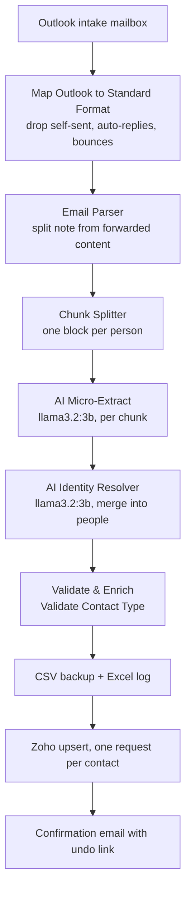

# Email-to-CRM

An n8n workflow that reads emails forwarded to one mailbox, extracts the people in them with a small language model running on your own hardware, and upserts them into Zoho CRM. The person who forwarded the email gets a confirmation listing what was saved, with a link that undoes it for 24 hours.

Email bodies never go to a hosted AI service. The model runs in Ollama next to n8n, on a mini-PC on the office network. The only outbound traffic is the contact record sent to Zoho and the confirmation email.

## Using it

Forward an email to the intake mailbox. If you want, add one line above the forwarded message saying what type of contact it is:

```text
From:    Pat Staffer <pat@yourcompany.com>
To:      contacts@yourcompany.com
Subject: FW: Intro - Northwind Logistics

Partner for Zoho

---------- Forwarded message ----------
From: Dana Reyes <dana.reyes@northwind-logistics.example>
...
Dana Reyes
Director of Partnerships
Northwind Logistics
Office: (555) 010-0142
Cell: (555) 010-0187
Columbus, OH
```

The parser treats the line mentioning Zoho or CRM as the instruction. For the email above it produces:

```json
{
  "forwarderInstruction": "Partner for Zoho",
  "suggestedType": "Partner",
  "forwarderPreamble": "Partner for Zoho\nPat Staffer\nYour Company"
}
```

That output is from running `workflows/test-workflow.json`'s Code nodes locally on this synthetic email. The type has to match the CRM picklist (`VALID_TYPES` in Validate Contact Type), and common variants are mapped through an alias table: "lender" becomes Financial Institution, "lawyer" becomes Attorney. Without a note, the type comes from the model's guess.

Each contact becomes one Zoho upsert, keyed on email:

| Zoho field | Comes from |
|---|---|
| `First_Name`, `Last_Name` | signature or header name |
| `Email` | the contact's address (dedup key) |
| `Title`, `Account_Name` | signature lines; company falls back to the email domain |
| `Phone`, `Mobile` | labeled numbers in the signature (office vs. cell/direct) |
| `Mailing_Street`, `Mailing_City`, `Mailing_State`, `Mailing_Country` | signature address, when present |
| `Type` | the forwarder's note, else the model's guess |
| `Description` | `Auto-imported via Email-to-CRM on <date>` |

Fields that fail validation are left out of the request rather than written blank. Confirmation subjects look like `[CRM] Added 1 contact: Dana Reyes` (or Updated, Skipped, Error), `[CRM] 2 contact(s) added/updated, 1 skipped: ...`, or `[CRM] No Contact Found`.

## How it works



That is the multi-stage workflow in `workflows/`. The single-stage design that runs in production makes one model call per email and puts the work in [`Parse_AI_Response.js`](src/nodes/Parse_AI_Response.js) instead: it checks each field the model returns against the email text, and a signature scanner fills in what the model missed. Its version of [`Validate_Contact_Type.js`](src/nodes/Validate_Contact_Type.js) also drops people who only appear on a forwarded To: or Cc: line, unless the note says "both of these", "the team", or names them.

In both versions everything except the model calls is plain JavaScript in n8n Code nodes, so a wrong result can be traced to a rule, and your own staff and signature are filtered out before anything is saved.

The CSV and Excel rows are written before Zoho is called. If the Zoho token refresh fails or the API is down, the contact is still in the log and the confirmation says Zoho was skipped. If nothing can be extracted (image-only body, auto-reply, newsletter), the forwarder gets a "No Contact Found" reply with the reason.

The undo link carries the Zoho record IDs, the contact emails, and an expiry 24 hours out, signed with HMAC-SHA256 using `UNDO_SECRET`. It points at an `undo-contact` webhook; the workflow that receives it is not part of this export.

Running on CPU is slow: a long forward takes a minute or two, which is fine for a mailbox that gets tens of emails a day.

## What's in the repo

There are two generations of the extraction logic, and they are at different stages:

| Path | What it is |
|---|---|
| `src/nodes/Parse_AI_Response.js` | Single-stage extraction node (one prompt, then a large deterministic signature scanner). This is the design the production deployment runs; the file is a slightly older revision. |
| `src/nodes/Validate_Contact_Type.js` | Contact filtering and type assignment for the single-stage path. |
| `src/nodes/Prepare_Zoho_Fetch.js`, `src/nodes/Detect_Image_Primary.js` | One Zoho fetch per upserted contact; detection of image-only bodies such as business-card photos. |
| `workflows/production-workflow.json` | The multi-stage version (chunk, extract, resolve identities). A prototype, not what production runs. |
| `workflows/test-workflow.json` | The same pipeline behind a webhook with Zoho stubbed out, for replaying emails. |
| `src/stages/` | Two stages of the multi-stage version as standalone files. |
| `infra/onprem-windows/` | PowerShell scripts that keep the Windows host recovering on its own after a reboot, with a runbook. |
| `docs/` | A decision record for the host setup, and [the signature formats the parser was tuned on](docs/edge-cases.md). |

> [!WARNING]
> The multi-stage prototype is not reliable on names yet. Running the synthetic email above twice with `llama3.2:3b`, the first run swapped Dana Reyes's first and last name, and the second put the forwarder's name (Pat Staffer) on Dana's email and phone. The forwarder's note also reaches the identity-resolver prompt but is not carried into its output, so the type is assigned without it. The single-stage node keeps the note and cross-checks names against the email address and signature; it has not been rerun on this example.

## Setting it up

1. Copy `.env.example` to `.env` and fill in `N8N_ENCRYPTION_KEY`, `ZOHO_CLIENT_ID`, `ZOHO_CLIENT_SECRET`, `ZOHO_REFRESH_TOKEN`, and `UNDO_SECRET`. `N8N_BLOCK_ENV_ACCESS_IN_NODE=false` lets Code nodes read them.
2. `docker compose up -d`. The warmup container pulls `llama3.2:3b` and keeps it loaded.
3. In n8n, create Microsoft Outlook and Microsoft Excel credentials and import a workflow from `workflows/`.
4. Replace the placeholders for your organization. Each Code node has its own copy because n8n Code nodes cannot import from each other:
   - your domain (`yourcompany.com`), intake address (`intake@example.com`), and staff names in the `OWN_*` constants and the two prompts, so your own people are never saved as contacts;
   - `VALID_TYPES` and `TYPE_ALIASES` in Validate Contact Type, to match your CRM picklist;
   - the `[CRM]` subject tag, if you change it, everywhere it appears (Prepare Confirmation Email sets it; Map Outlook to Standard Format and Chunk Splitter filter on it).
5. On a Windows host, run `infra/onprem-windows/harden.ps1` once as administrator. It registers the watchdog task, disables sleep and hibernate, and blocks forced update reboots. Details are in [the runbook](infra/onprem-windows/README.md).

## Provenance

This is a cleaned-up export of a private repository that serves a live deployment. The run history, audit logs, replay harness, and regression fixtures built from real emails stay private. Names, domains, phone numbers, hostnames, and the original contact-type list were replaced with placeholders. Secrets are read from the environment and were never in the code.

Written by Mika Sibinkic (Null Systems). Claude was used as a pair programmer on the node code, the regression tooling, and this export, and commits it helped with carry a `Co-Authored-By` trailer.
